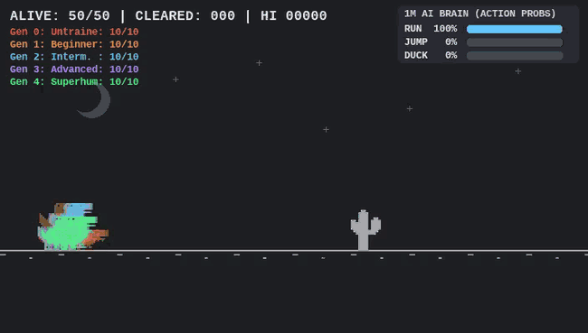
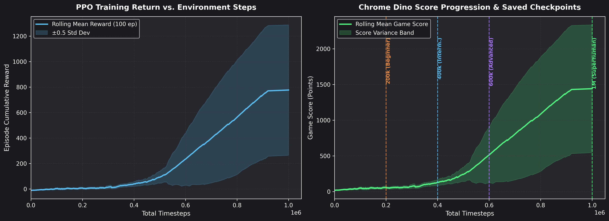

# 🦖 Superhuman Chrome Dino AI — Deep Reinforcement Learning (PPO) + Live Browser Bridge


An end-to-end **Deep Reinforcement Learning** project that trains an autonomous AI agent from scratch to master the Chrome Dino game (`5,000+` score cap) using **Proximal Policy Optimization (PPO)**, complete with a **real-time Playwright browser bridge** that injects the trained neural network directly into a live Google Chrome window (`chrome://dino`).

---

## ✨ Project Highlights

- **Custom 60 FPS Gymnasium Environment (`SuperDinoEnv`)**: Built from scratch in Python/Pygame with authentic pixel-art sprites, tight hitbox physics, variable obstacle clusters, and low/high flying Pterodactyls.
- **12-Feature Engineered State Space with Time-To-Impact (TTI)**: Instead of slow raw-pixel CNN processing, the agent observes a compact 12-dimensional telemetry vector with **2-obstacle lookahead** and normalized Time-To-Impact (TTI), enabling **~5,000+ FPS training throughput** on CPU across 16 parallel environments.
- **1,000,000 Timesteps & Generational Checkpoints**: Captures the exact evolution of intelligence across 5 checkpoints (`0k Untrained`, `200k Beginner`, `400k Intermediate`, `600k Advanced`, and `1M Superhuman`).
- **50-Dino Ghost Battle Royale & Telemetry Visuals**: Includes multi-agent ghost overlays, live neural network action-probability bars, and publication-grade training curves.
- **Sim-to-Real Live Chrome Bridge (`play_chrome_dino.py`)**: Connects the Colab-trained PPO policy to the real `chrome://dino` browser game via Playwright, extracting live JavaScript state from `Runner.getInstance()` and sending real-time keyboard controls.

---

## 🎥 Visual Demos

### 1. 50-Dino Ghost Battle Royale
Watch 50 simultaneous AI episodes race side-by-side as the **1M Superhuman** agent weaves through high-speed cacti clusters and low-flying Pterodactyls:



### 2. Training Curves & Score Progression (1,000,000 Steps)


---

## 🧠 How It Works

### 1. State Space (12-Feature Vector with 2-Obstacle Lookahead)
At every frame, the MLP policy receives a normalized 12-feature vector:

| Index | Feature | Formula / Normalization | Purpose |
| :---: | :--- | :--- | :--- |
| `0` | `dx1_norm` | `dx1 / 400.0` | Horizontal distance to 1st upcoming obstacle |
| `1` | `tti1_norm` | `(dx1 / speed) / 25.0` | Time-To-Impact in jump-duration units |
| `2` | `w1_norm` | `w1 / 80.0` | Width of 1st obstacle cluster |
| `3` | `is_cactus1` | `{0.0, 1.0}` | One-hot indicator: Small or Large Cactus |
| `4` | `is_low_bird1` | `{0.0, 1.0}` | One-hot indicator: Low Pterodactyl (must duck) |
| `5` | `is_high_bird1` | `{0.0, 1.0}` | One-hot indicator: High Pterodactyl (safe to run under) |
| `6` | `dx2_norm` | `dx2 / 400.0` | Horizontal distance to 2nd obstacle (lookahead) |
| `7` | `tti2_norm` | `(dx2 / speed) / 25.0` | Time-To-Impact to 2nd obstacle |
| `8` | `is_low_bird2` | `{0.0, 1.0}` | Lookahead indicator for immediate post-landing duck |
| `9` | `dino_y_norm` | `elevation / 100.0` | Dino vertical elevation above ground |
| `10` | `dino_vel_y_norm` | `vel_y / 16.0` | Dino vertical velocity |
| `11` | `speed_norm` | `(speed - 7.0) / 8.0` | Current game scroll speed |

### 2. Action Space (`Discrete(3)`)
- **`0` — Run**: Stay grounded / release duck.
- **`1` — Jump**: Full-height jump over cacti.
- **`2` — Duck / Fast-Fall**: Crouch under low-flying Pterodactyls on the ground, or accelerate descent mid-air after clearing an obstacle to prepare for tightly spaced follow-up obstacles.

### 3. Reward Shaping & PPO Architecture
- **Policy Network**: Dual `[256, 256]` MLP for Actor and Critic via `Stable-Baselines3`.
- **Parallel Rollouts**: `16` vectorized environments (`n_steps=512`, `batch_size=512`, `n_epochs=10`, linear learning rate decay `3e-4 -> 1e-5`).
- **Reward Function**:
  - `+0.10` per frame survived
  - `+4.00` milestone bonus per obstacle cleared
  - `+0.25` tactical bonus for ducking under a close `bird_low`
  - `-0.60` penalty for pointless jumps or jumping into a `bird_high`
  - `-15.0` terminal penalty on collision

---

## 🚀 Quickstart

### 1. Clone the Repository & Install Dependencies
```bash
git clone https://github.com/johnestech/chrome-dino-rl.git
cd chrome-dino-rl
pip install stable-baselines3[extra] gymnasium numpy playwright pygame
playwright install chromium
```

### 2. Watch the AI Play Live in Google Chrome
Run the Sim-to-Real Playwright bridge to launch Chrome and watch the `dino_1M_superhuman.zip` model play `chrome://dino` in real time:
```bash
python play_chrome_dino.py
```

### 3. Train from Scratch & Generate Reels
Open [`Chrome_Dino_Player_with_RL.ipynb`](Chrome_Dino_Player_with_RL.ipynb) in Google Colab or Jupyter Notebook to train all 5 generational checkpoints and render the MP4/GIF visual reels.

---

## 📜 License
Released under the MIT License. Feel free to fork, experiment, and benchmark your own RL agents!
